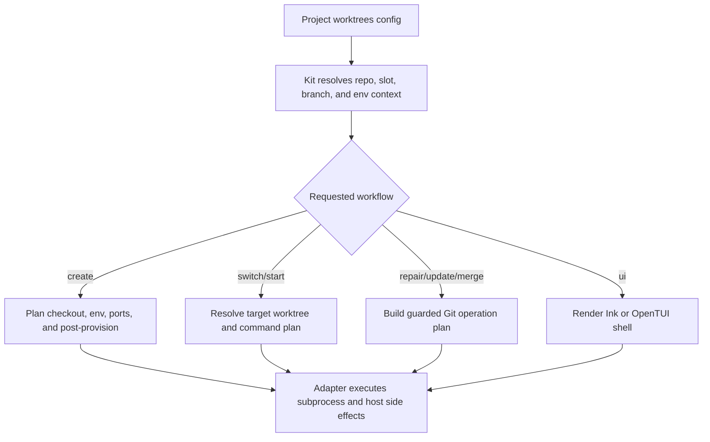

# @gg-utils/worktree-kit

Reusable, config-driven worktree command, lifecycle, sync, and terminal UI primitives.

This package composes `@gg-utils/worktree-core` with env-file helpers, local-state sync helpers,
prepared-worktree lifecycle commands, start/switch/destroy/update/merge/repair flows, Ink shells,
OpenTUI shells, action catalogs, command previews, and IDE workspace integration helpers. It is the
kit layer: project policy belongs in explicit config and thin adapters.

## Install

```bash
npm install @gg-utils/worktree-kit@git+https://github.com/gg-utils/worktree-kit.git#main
```

Pinned dependency example:

```json
{
  "dependencies": {
    "@gg-utils/worktree-kit": "git+https://github.com/gg-utils/worktree-kit.git#99d9825"
  }
}
```

## When To Use

- You need a reusable worktree CLI or UI driven by project config.
- You need prepared-worktree create, switch, destroy, repair, merge, or update flows.
- You need slot-to-port maps, configured submodule sync, local-state sync, or repo-root sync.
- You need Ink/OpenTUI action shells without hardcoding project command names into the package.
- You need integration helpers for editor workspaces or shell aliases.

Skip this package when you only need low-level Git/worktree primitives; use
`@gg-utils/worktree-core`.

## Public Surfaces

| Import | Purpose |
|---|---|
| `@gg-utils/worktree-kit/slot-ports` | Derive slot-shifted port maps. |
| `@gg-utils/worktree-kit/configured-submodules` | Config-driven submodule discovery and sync. |
| `@gg-utils/worktree-kit/create-command` | Prepared-worktree create runner. |
| `@gg-utils/worktree-kit/switch-command` | Config-driven switch command helpers. |
| `@gg-utils/worktree-kit/destroy-command` | Config-driven destroy command helpers. |
| `@gg-utils/worktree-kit/update-from-main-command` | Update prepared worktrees from main. |
| `@gg-utils/worktree-kit/merge-command` | Merge workflow helpers. |
| `@gg-utils/worktree-kit/repair-command` | Repair workflow helpers. |
| `@gg-utils/worktree-kit/start-command` | Config-driven start flow helpers. |
| `@gg-utils/worktree-kit/ink-app` | Reusable React/Ink app controller. |
| `@gg-utils/worktree-kit/ink-shell` | Reusable Ink shell renderer. |
| `@gg-utils/worktree-kit/opentui-app-shell` | Reusable OpenTUI shell layout. |
| `@gg-utils/worktree-kit/opentui-action-scroll` | OpenTUI action-scroll composition. |
| `@gg-utils/worktree-kit/ui-command-catalog` | UI command catalog contracts. |

The package exposes many narrower subpaths for large UI and command surfaces. Prefer the narrow
subpath when a consumer only needs one helper.

## Quick Start

```ts
import { WorktreeStackKit_deriveSlotPortMap } from "@gg-utils/worktree-kit";

const ports = WorktreeStackKit_deriveSlotPortMap({
  portDefinitions: [
    { basePort: 3000, key: "web" },
    { basePort: 4000, key: "api" },
  ],
  slot: 2,
});

console.log(ports);
```

## Operational Flow



## Development

```bash
git clone https://github.com/gg-utils/worktree-kit.git
cd worktree-kit
npm run type-check
npm test
npm run build
```

Scripts currently expect the source-first workspace toolchain.

## Layout

```text
.
|-- src/*-command.ts                 # Prepared-worktree command helpers
|-- src/ink-*.ts                     # Ink state, models, controllers, and renderers
|-- src/opentui-*.ts                 # OpenTUI planning and render helpers
|-- src/configured-submodules.ts
|-- src/local-state-sync.ts
|-- src/ui-command-catalog.ts
|-- dist/
`-- package.json
```

## Caveats

- The kit is config-driven; project paths, branch policies, labels, command names, and env overlays
  must be supplied by the consuming repo.
- Host side effects and subprocess execution remain adapter-owned unless explicitly injected.
- The package depends on `@gg-utils/worktree-core` and `@gg-utils/env-materialize-core`.
